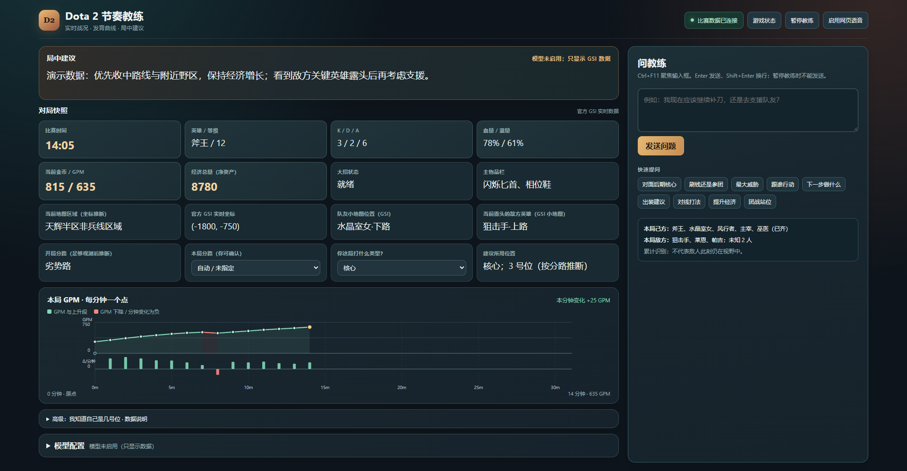

# Dota 2 新手节奏教练

一个在本机运行的 Dota 2 对局页面。它通过游戏自带的 Game State Integration（GSI）读取实时状态，显示经济、GPM 曲线和地图信息；配置模型后，还能给出中文建议和回答局中问题。**不配置模型也能看数据。**



> 截图使用模拟对局数据，仅用于展示界面。

## 页面能看到什么

- 比赛时间、英雄、KDA、血蓝、当前金币、经济总量（净资产）、GPM、大招和装备。
- 每分钟一个点的 GPM 曲线，以及相邻两分钟的 GPM 变化。曲线会随对局时长向右延长；下降段标红。GPM 是开局至当前的平均值，变化柱**不是**该分钟实际赚到的金币。
- 队友小地图位置、当前露头的敌人和近似地图区域。分路和位置判断是程序推断，可在页面手动修正。
- 可选的模型建议、局中提问和语音播报。默认约每 45 秒检查一次，也会在部分重要状态变化时检查。

## 快速开始（Windows）

需要 Python 3.10 或更新版本，以及已安装的 Dota 2。本项目无需额外安装 Python 包。

1. 在 Steam 中打开 **Dota 2 → 管理 → 浏览本地文件**。进入 `game\dota\cfg\gamestate_integration\`，把仓库里的 [`gamestate_integration_coach.cfg`](gamestate_integration_coach.cfg) 复制进去；没有这个文件夹就新建。
2. 在 Steam 的 Dota 2 **启动选项**中加入 `-gamestateintegration`，保留原有启动参数，然后重启游戏。
3. 在本仓库目录打开 PowerShell，运行：

   ```powershell
   python coach.py
   ```

4. 浏览器打开 <http://127.0.0.1:5000/>。进入对局后，页面会开始显示数据。结束时在运行程序的终端按 **Ctrl+C**。

只想看文字、不使用后台语音，可以运行 `python coach.py --no-voice`。若页面一直显示等待游戏数据，先检查配置文件位置、Steam 启动选项和游戏是否已重启。

## 启用 AI 建议

在页面的“模型配置”中选择 OpenRouter、DeepSeek 或 OpenAI，填写模型 ID 和 API Key，再保存。密钥只保存在当前服务进程的内存里，重启后需要重新填写。模型请求可能产生费用；没有配置或请求失败时，实时数据仍可用。

页面顶部可以暂停或恢复教练。暂停后仍接收和显示 GSI 数据，但不会发起新的模型请求。也可以用 `python coach.py --ai-provider off` 明确只看数据；`--interval 30` 至 `--interval 120` 可调整常规检查间隔。

## 局中提问快捷键（可选）

在另一个 PowerShell 窗口运行 `python hotkey_helper.py`，并在 Chrome 中打开教练页面。按 **Ctrl+F11** 会把该 Chrome 窗口切到前台，方便输入问题；它不会修改 Dota 2 的按键或画面设置。输入框中按 **Enter** 发送，**Shift+Enter** 换行。停止快捷键程序时，在它的终端按 **Ctrl+C**。

## 数据与隐私

- 服务只监听本机 `127.0.0.1`。启用模型后，程序会把筛选过的英雄、时间、状态、装备、位置等对局信息及你手动输入的问题发给所选服务商；不会发送完整 GSI 包、账号信息或比赛 ID。
- 经济总量直接读取 GSI 的 `player.net_worth`。游戏没有提供该字段时显示“未知”，不会用当前金币或 GPM 猜测。
- 小地图区域、开局分路和位置是近似判断；不能据此确定敌方真实去向、视野或准确的 1～5 号位。
- 本局阵容和逐分钟 GPM 保存在本机 `match_memory.json`，手动补充信息保存在 `manual_context.json`。这些文件已被 Git 忽略。

## 开发验证

运行 `python -m unittest -v` 检查数据解析和页面服务逻辑。测试使用模拟 GSI 数据；实际游戏连接仍需在对局中验证。

项目基于 Dota 2 的 GSI 数据。字段可能随游戏版本变化；缺失字段会显示为“未知”。
